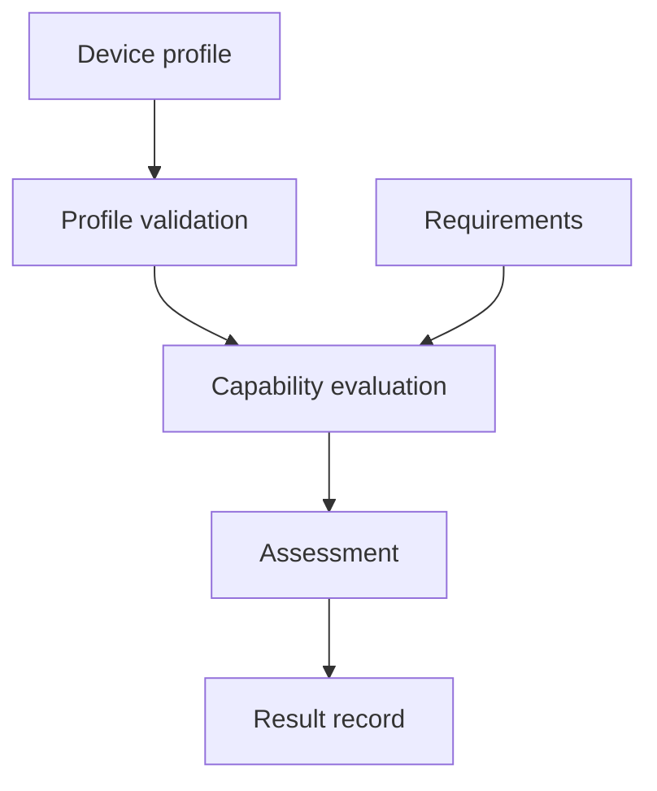

# System Overview

Status: Proposed architecture. The foundation implementation has not started.

## The problem

A development board, firmware manifest, or configuration file can describe a processor and its capabilities. Those descriptions are useful for software decisions, but they are not hardware measurements and do not prove that a device is trustworthy.

SILIARCH begins by making that distinction explicit. The first component will read a structured profile, check its format, and compare declared capabilities with an engineering requirement.

## Foundation data flow

These boxes describe planned software components, not completed modules.

A valid assessment means the supplied declaration satisfies a defined requirement. It says nothing by itself about the real device, firmware integrity, or the origin of the declaration.

## Planned component boundaries

| Component | Responsibility | Out of scope |
|---|---|---|
| Profile parser | Read structured input | Verify the source of the profile |
| Validator | Check required fields, types, and limits | Prove physical capabilities |
| Evaluator | Compare validated claims with requirements | Infer unspecified features |
| Result writer | Record the outcome and reason | Invent tests or supporting evidence |

The parser and validator must reject malformed input. The evaluator must not silently substitute defaults for missing security-relevant properties.

## First data contract

The first schema will be versioned and small. Candidate fields are:

| Field | Meaning |
|---|---|
| `schema_version` | Profile format version |
| `device_id` | Profile identifier, not a verified device identity |
| `architecture` | Claimed processor architecture |
| `memory_bytes` | Claimed memory capacity in bytes |
| `capabilities` | Claimed hardware features |

Allowed values, type checks, limits, and unknown-field behavior must be specified before implementation. A schema may change between experimental versions.

### Worked example

Suppose a fictional board profile claims an ARM64 processor, 65,536 bytes of memory, and a UART interface. An application requires ARM64, at least 32,768 bytes of memory, and UART.

The evaluator should report that the *declared* profile matches. It must not report that the physical board was inspected or attested.

Malformed input should produce a validation error rather than a successful or unsuccessful capability assessment.

## Long-term architecture

| Layer | Purpose | Initial state |
|---|---|---|
| Device Capability | Describe device properties | Foundation target |
| Portable Core | Validate and evaluate profiles | Foundation target |
| Hardware Adapters | Collect platform-specific information | Future work |
| Trust and Attestation | Verify identities and integrity evidence | Future work |
| Verification | Run simulations, tests, and formal checks | Starts with unit tests |
| Evidence and Provenance | Preserve test context and findings | Starts with local results |
| AI Extensions | Assist bounded research tasks | Future work |

A hardware adapter will need an explicit support matrix and test evidence for each platform. Shared processor architecture does not guarantee shared peripherals, firmware behavior, or security properties.

## Initial boundaries

The first prototype will not perform secure boot, verify cryptographic attestations, inspect live hardware, or guarantee platform compatibility.

It will run locally using Python and its standard library where practical. RTL and hardware measurement tools will be added when there are testable requirements for them.

## Engineering acceptance

The foundation is ready for review when:

1. The profile format is documented.
2. Valid and invalid inputs have deterministic outcomes.
3. Unit tests cover missing, malformed, unsupported, and boundary-value cases.
4. The executable and tests run from documented commands.
5. A result clearly distinguishes a declaration from a verified hardware property.

See [Trust and Evidence](TRUST_AND_EVIDENCE.md), [Roadmap](../ROADMAP.md), and [ADR-0001](../decisions/0001-foundation-first.md).
